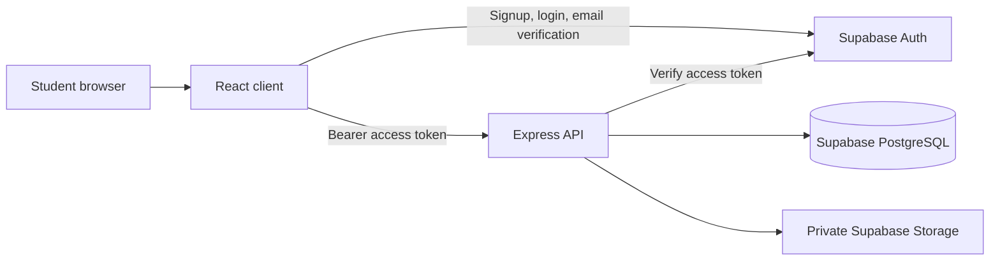

# Lendly — Campus Borrowing Platform

**Borrow More. Buy Less. Share Campus Resources.** Lendly helps students share useful campus items. The implementation includes the responsive landing page, Supabase Auth flows, protected profile management, moderated listings, private photo uploads, search and filters, campus bookings, messaging, notifications, dispute review, and demo or Razorpay test payment paths. It is still a development build and needs hosted services, applied migrations, end-to-end verification, and operational review before real student use.

## Stack

- React 18, Vite, React Router, React Hook Form, Zod, and Lucide
- Node.js 20+ and Express 4 with Zod validation, Helmet, CORS, and rate limiting
- Supabase Auth, PostgreSQL, and Storage
- npm workspaces

## Architecture



Protected business requests go through the API. The server validates the Supabase access token and enforces account role and record ownership. The service-role key stays on the server. Public browser configuration uses only the Supabase anon key.

## Requirements

- Node.js 20.19+ or 22.12+ (Node 24.20 was detected while creating this scaffold)
- npm 10 or newer
- Docker Desktop for the local Supabase stack
- A Supabase account/project for hosted authentication and database setup

## Windows PowerShell: install and run

Open PowerShell in the repository root:

```powershell
cd E:\Engineering_Year2\Career_Development\Projects\Lendly
npm install
Copy-Item client/.env.example client/.env
Copy-Item server/.env.example server/.env
npm run dev
```

The frontend is at `http://localhost:5173`. The API health check is `http://localhost:4000/api/v1/health`. The API can start before Supabase is configured; protected account operations report a clear setup error until valid keys are provided.

`client/.env` contains browser-visible values. Only `VITE_API_URL`, `VITE_SUPABASE_URL`, and `VITE_SUPABASE_ANON_KEY` belong there. The anon key is public by design and relies on RLS. Never put the service-role key, database password, or payment secret in a `VITE_` variable. `server/.env` is server-only and must not be committed.

## Supabase setup

1. Create a Supabase project. Set its URL and anon key in both env examples; set the service-role key only in `server/.env`.
2. In Supabase Auth, enable email confirmations. Set the local site URL to `http://localhost:5173` and add the local redirect URL. Configure a real SMTP provider before expecting production email delivery.
3. The default allowed domain is `kongu.edu`. The server and database both validate the exact domain. Email-domain matching does not prove student identity; confirmation is required.
4. From the repository root, apply migrations to your linked project:

   ```powershell
   npx supabase login
   npx supabase link --project-ref YOUR_PROJECT_REF
   npx supabase db push
   ```

5. For a local stack, start Docker Desktop, run `npx supabase start`, then `npx supabase db reset`. **This reset recreates the local database. Do not run it against production.** Local Auth emails can be inspected in the Supabase Inbucket service.
6. The `item-photos` bucket is private. The API must perform ownership-checked uploads and generate signed view URLs. No direct browser-write policy or service key is provided.

## Payment setup and behavior

- `PAYMENT_MODE=demo` is the safe default. It records a clearly labeled simulation and never contacts Razorpay or collects money.
- `PAYMENT_MODE=disabled` confirms accepted bookings without a payment step.
- `PAYMENT_MODE=razorpay_test` requires server-only Razorpay test credentials. The API refuses a key ID without the `rzp_test_` prefix. Keep all three Razorpay values in `server/.env` or the hosting secret manager; never add them to a `VITE_` variable.
- The server calculates the order amount, creates the provider order, verifies checkout signatures, checks payment status with Razorpay, and verifies webhook signatures against the exact raw body. Razorpay test payments must be configured for automatic capture; the app confirms only a captured payment.
- Test-mode deposit refunds require borrower request and admin review. Approval does not issue a refund: an operator issues the partial deposit refund in the Razorpay test dashboard and records the returned `rfnd_` reference in the admin page. Demo payments cannot be refunded because no money was collected.
- Students can report listings; verified borrowers and lenders can report a booking. Administrators triage, resolve, or dismiss reports with an audit record.
- The Render Blueprint includes a daily scheduler for the protected overdue endpoint. It sends in-app reminders after the configurable grace period and records one auditable late-fee calculation per overdue day; it never collects a fee. Administrators can confirm or waive the calculation. Other hosts need a scheduler configured as described in [docs/deployment.md](docs/deployment.md).
- Set `OVERDUE_GRACE_DAYS` in `server/.env` (default `1`) and a random `CRON_SECRET` of at least 32 characters. The Render Blueprint generates the server secret and shares it with the Cron service. Repeated calls on the same day are idempotent. If a scheduled day is missed, the next run backfills the daily fee records; reminders are sent for the run date.
- No real payment mode is implemented. See [docs/deployment.md](docs/deployment.md) for provider setup and [docs/security.md](docs/security.md) for security limits.

## Project structure

```text
client/                 React/Vite browser application
  src/components/       Shared UI components
  src/features/         Marketplace feature modules
  src/pages/            Route pages
  src/services/         Supabase Auth and API clients
server/                 Express REST API
  src/config/           Validated environment and Supabase clients
  src/middleware/       Token, role, error, and request guards
  src/routes/           Versioned API routes
  src/services/         Business operations
  tests/                Node test-runner API and unit tests
supabase/migrations/    Ordered PostgreSQL schema changes
supabase/seed.sql       Safe local catalog seed data only
docs/                   Architecture, security, schema, and operations notes
```

## Commands (from the repository root)

- `npm run dev` — start the API and frontend together.
- `npm run build` — production-build the client and syntax-check the server.
- `npm test` — run server and client tests.
- `npm run lint` — lint client and server JavaScript.
- `npm start` — start the Express API.

## Troubleshooting

- **The API says Supabase is not configured:** confirm `server/.env` has the project URL, anon key, and service-role key. Restart `npm run dev` after changing env files.
- **Protected pages do not load:** set the same project URL and public anon key in `client/.env`, verify the account's college email, and confirm the server uses the allowed domain. Never copy the service-role key to the client.
- **Verification or recovery links return to the wrong page:** add `http://localhost:5173/auth/callback` and `http://localhost:5173/reset-password` to Supabase Auth's local redirect allowlist. Production URLs must be configured separately.
- **Database operations return a setup or missing-schema error:** from the repository root, authenticate and link the intended Supabase project, then run `npx supabase db push`. Check the project ref before applying changes. For local development only, `npx supabase db reset` recreates the local database and reapplies migrations and seed data.
- **The browser reports a CORS error:** set `CLIENT_ORIGINS` in `server/.env` to the exact frontend origin, such as `http://localhost:5173`, then restart the API.
- **Razorpay checkout is unavailable:** keep `PAYMENT_MODE=demo` until valid test credentials are configured in `server/.env`. The project has no live-payment mode.
- **The dev server reports a port conflict:** close the earlier Lendly dev terminal, then run `npm run dev` again. If another application owns the port, change the server `PORT` and the Vite `server.port`, then update `VITE_API_URL` to match.

## Safe first administrator

Create and verify a normal college-email account. Then, from the Supabase SQL editor or another secured operator session, follow the one-user role update in [docs/security.md](docs/security.md). Do not create a public admin signup path and do not share a service-role key.

## Legal and operational readiness

Terms, privacy, borrowing, cancellation, deposit, and dispute content are draft templates that need appropriate review before public commercial use. Error monitoring, approved retention periods and deletion, backup restoration, and a real support contact still need owner setup. The Render scheduler is configured in code but must be deployed and verified. See [docs/operational-readiness.md](docs/operational-readiness.md) and [docs/data-retention.md](docs/data-retention.md). No live payment mode, deposit hold, or late-fee collection is implemented. Refunds are limited to an auditable test-mode request and manual provider-dashboard workflow.

## Deployment

Follow [docs/deployment.md](docs/deployment.md) for Supabase, Render, and Vercel setup. `render.yaml` and `vercel.json` prepare the host configurations; no hosting credentials or production URL have been provided, so no public deployment is claimed. Review Render's current Starter plan pricing before creating the service.

## Current implementation status

- **Implemented:** local landing and authentication screens; server-checked college email; profile editing; listing create/edit/archive/pause; private photo upload and removal; campus-scoped discovery, filters, pagination, and related items; booking requests and lifecycle; private conversations; notifications; listing reports and booking disputes; student ratings and review history; admin overview counts, account directory, booking oversight, listing moderation and audited removal, report/dispute/refund/late-fee review, security event review, and audit history; configurable overdue reminders and auditable daily fee calculations; demo payment; and Razorpay test orders, signature checks and webhook processing.
- **Local verification:** run `npm run lint`, `npm test`, and `npm run build` from the repository root. Passing local checks do not verify Supabase SQL or Razorpay network behavior.
- **Needs account setup:** configure Supabase URL and keys, apply migrations, configure email delivery and redirects, then verify signup and the full workflow against the database.
- **Payment setup:** see [docs/payments.md](docs/payments.md) for safe demo, disabled, Razorpay test, and manual deposit-refund steps.
- **Still to build or verify:** applying migrations to hosted Supabase and checking provider-specific Auth/RLS/Storage behavior; a real Razorpay test checkout/webhook/refund walkthrough with owner credentials; a full multi-account browser workflow; deploying and exercising the Render overdue scheduler; and production deployment.
- **Not validated here:** all 10 migrations were accepted in order by a disposable PostgreSQL 18 instance with minimal Auth/Storage compatibility schemas. This checks PostgreSQL syntax and sequence, not Supabase-specific behavior. No migration was applied to a hosted project; provider network requests and public deployment are not verified. No live payment is claimed.
- **Before launch:** obtain legal review for the draft policies, publish a support contact, define retention and deletion, configure monitoring and backups, and complete a security review with test accounts.
