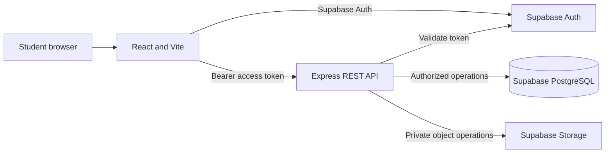

# Architecture

The React/Vite client handles accessible screens and Supabase Auth sessions. It calls the versioned Express API with the current access token for business operations. The API verifies every protected token with Supabase Auth, checks account role and object ownership, then uses a server-only Supabase service client for PostgreSQL and Storage. Booking prices and lifecycle actions, message delivery, and moderation updates use narrowly scoped PostgreSQL functions granted only to the service role. The browser only receives the public anon key. PostgreSQL RLS is enabled as defense in depth; private writes go through the API.

The API is unavailable for private business actions until server environment credentials are configured. The health endpoint is independent of Supabase so the server can be started before external setup.

Students submit listing or booking reports through authenticated API routes. Administrators review reports and calculated late fees through role-protected routes. A hosting scheduler calls the overdue endpoint once per day using a server-only `CRON_SECRET`; the API runs an idempotent database function that creates in-app reminders and fee calculations without collecting money.

Payment operations use a backend-controlled mode (`disabled`, `demo`, or `razorpay_test`). In test mode, the API creates Razorpay orders and verifies callbacks and webhooks; payment and refund references are stored separately from deposit records. The webhook route is public but accepts only signatures verified against the preserved raw request body. No live payment mode is available.
